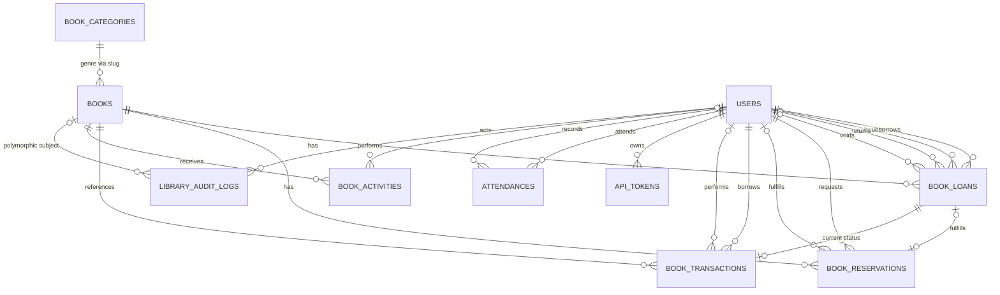

# LBMS Database Structure

This document describes the live MySQL schema and the Laravel application code inspected on 2026-10-21. The application database is `lbms`; the connection is MySQL. Laravel's sessions, cache, and queue are also configured to use database tables.

## Design summary

- `books.id`, `users.id`, and the other library-table `id` columns are the existing primary keys. They are retained; the suggested alternate names such as `book_id` are not needed.
- A book's `category` is its library section (`book`, `study`, or `manga`). Its nullable `genre` points to `book_categories.slug`. These are different concepts, so there is no `category_id` on `books`.
- `books.total_copies` is the stored stock count. Available copies are calculated from this value minus active loans, and are zero when the title's `condition_status` is not `available`. There is no stored `available_quantity` to become stale.
- `books.barcode` is the existing unique field used by the UI as “Barcode / ISBN.” There is no separate `isbn` column.
- Loan state is stored in `book_loans`: `returned_at` and `voided_at` are nullable state markers; the displayed status is calculated from these timestamps and `due_at`.
- `book_transactions` contains one current status row per non-voided loan, enforced by a unique `book_loan_id`. A return updates that row; a void removes it. `book_loans` and `library_audit_logs` preserve the loan and administrative history.
- A safe migration adds missing genre-category rows for the existing books, then adds a foreign key from `books.genre` to `book_categories.slug`. It does not rewrite or remove existing book rows.

## Library tables

### `books`

| Column | Meaning |
| --- | --- |
| `id` | Auto-incrementing primary key |
| `slug` | Unique route/catalog identifier |
| `category` | Section: `book`, `study`, or `manga` |
| `genre` | Nullable genre key; foreign key to `book_categories.slug` |
| `title`, `author` | Catalog title and author |
| `description` | Catalog description |
| `cover_url` | Optional cover-image URL |
| `illustrations` | Optional JSON illustration URLs and captions |
| `content` | Long-form reading content |
| `source_label`, `source_url` | Optional content attribution |
| `total_copies` | Physical-copy count; unsigned integer, defaults to 1 |
| `barcode` | Optional unique barcode/ISBN value |
| `condition_status` | Title-wide condition: available, maintenance, damaged, or lost |
| `created_at`, `updated_at` | Laravel timestamps |

**Keys and indexes:** primary key `id`; unique `slug`; unique nullable `barcode`; index on `condition_status`; foreign key `genre` → `book_categories.slug` (added by the genre-integrity migration); foreign keys from loans, reservations, and activity records reference `books.id`.

### `book_categories`

Stores the category/genre names shown in book forms and filters; it is not the section field on `books`.

| Column | Meaning |
| --- | --- |
| `id` | Auto-incrementing primary key |
| `slug` | Unique key stored in `books.genre` |
| `name` | Unique display name |
| `created_at`, `updated_at` | Laravel timestamps |

**Relationship:** one genre category has many books through `books.genre` → `book_categories.slug`. The schema currently has no description field.

### `users`

User accounts continue to use Laravel's standard authentication columns and primary key.

| Column | Meaning |
| --- | --- |
| `id` | Auto-incrementing primary key |
| `name`, `email` | Account name and unique login email |
| `role` | Application role, normally `admin`, `staff`, or `student` |
| `is_admin` | Additional boolean administrator flag |
| `password`, `remember_token`, `email_verified_at` | Laravel authentication fields |
| `profile_photo_path` | Optional profile image path |
| `student_id` | Optional unique student identifier |
| `first_name`, `last_name`, `course`, `year_level` | Optional student profile fields |
| `created_at`, `updated_at` | Laravel timestamps |

Passwords use Laravel's hashed cast. `student_id` is nullable and unique. `role` and `is_admin` overlap for admin accounts; both remain because existing authorization code uses both.

### `book_loans`

Authoritative borrowing record and status history for a single borrower/book loan.

| Column | Meaning |
| --- | --- |
| `id` | Auto-incrementing primary key |
| `book_id` | Borrowed title; references `books.id` |
| `borrower_id` | Borrowing student; references `users.id` |
| `issued_by`, `returned_by`, `voided_by` | Nullable staff/user actor references |
| `borrowed_at`, `due_at` | Issue time and due timestamp |
| `returned_at`, `voided_at` | Nullable return and void timestamps |
| `fine_amount` | Fine calculated when returned, decimal(10,2), defaults to 0 |
| `fine_paid_at` | Nullable fine-payment timestamp |
| `due_reminded_at`, `overdue_reminded_at` | Nullable reminder timestamps |
| `created_at`, `updated_at` | Laravel timestamps |

**Indexes:** `(borrower_id, returned_at)`, `(book_id, returned_at)`, and `(due_at, returned_at)`. Book and borrower deletion is restricted while loans exist; nullable staff references become null if the staff account is deleted.

**Status and stock:** there is no stored `status` or `available_quantity` column. Current status is derived from `voided_at`, `returned_at`, and `due_at`. Active-copy counts exclude returned and voided loans.

### `book_reservations`

| Column | Meaning |
| --- | --- |
| `id` | Auto-incrementing primary key |
| `book_id` | Reserved title; references `books.id` |
| `student_id` | Requesting student; references `users.id` |
| `fulfilled_by` | Nullable staff/user who fulfilled it |
| `loan_id` | Nullable unique link to the loan created on fulfillment |
| `status` | Current value is `pending`, `fulfilled`, or `cancelled`; defaults to `pending` |
| `requested_at`, `fulfilled_at` | Request and optional fulfillment timestamps |
| `created_at`, `updated_at` | Laravel timestamps |

**Indexes:** `(book_id, status, requested_at)`, `(student_id, status)`, and unique `loan_id`. Reservations are issued in request order. The current schema has no `expires_at` column or automatic expiration behavior.

### `book_transactions`

One current status row per loan, not an append-only event ledger. The `book_loan_id` unique index enforces at most one row per loan.

| Column | Meaning |
| --- | --- |
| `id` | Auto-incrementing primary key |
| `book_loan_id` | Unique link to `book_loans.id` |
| `book_id`, `borrower_id` | Denormalized book and borrower IDs used by existing API/list queries |
| `performed_by` | Nullable user who most recently performed the recorded action |
| `transaction_type` | Current row state, normally `borrowed` or `returned` |
| `transaction_at` | Timestamp of the row's current state |
| `fine_amount` | Fine snapshot for a returned loan |
| `details` | Optional JSON source/metadata |
| `created_at`, `updated_at` | Laravel timestamps |

The book, borrower, performer, and fine fields overlap with `book_loans`. They are retained because current API responses and queries consume them. Voided state is held in `book_loans`, and the event is in `library_audit_logs`; voiding removes the status row.

**Indexes:** unique `book_loan_id`; `(transaction_type, transaction_at)`, `(borrower_id, transaction_at)`, and `(book_id, transaction_at)`. Book, loan, and borrower deletion are restricted; a deleted performer is set to null.

### `library_audit_logs`

Preserves administrative and business actions such as catalog changes, loan issue/return/void, reservation changes, and user management.

| Column | Meaning |
| --- | --- |
| `id` | Auto-incrementing primary key |
| `user_id` | Nullable actor reference to `users.id`; set null if the account is removed |
| `action` | Event/action name |
| `subject_type`, `subject_id` | Nullable polymorphic reference to the affected model |
| `details` | Nullable JSON event context |
| `created_at`, `updated_at` | Laravel timestamps |

**Indexes:** `(subject_type, subject_id)` and `(action, created_at)`. The subject pair is polymorphic and intentionally cannot use one ordinary foreign key.

### Other application tables

| Table | Columns and purpose | Keys/relationships |
| --- | --- | --- |
| `api_tokens` | `id`, `user_id`, `name`, `token_hash`, `expires_at`, `last_used_at`, timestamps; stores hashed API tokens and expiry/use data. | `user_id` cascades from users; unique `token_hash`; index `expires_at`. |
| `attendances` | `id`, `user_id`, `recorded_by`, `time_in`, `time_out`, timestamps; clock-in/out records. | `user_id` cascades on user deletion; `recorded_by` restricts deletion; index `(user_id, time_in)`. |
| `book_activities` | `id`, `user_id`, `book_id`, `type`, timestamps; reading views/favorites. | User and book foreign keys cascade; indexes `(user_id, type, created_at)` and `(user_id, book_id, type)`. |
| `login_page_settings` | Singleton `id` (unsigned tiny integer), nullable `image_path`, nullable `updated_by`, timestamps; custom login-banner setting. | `id` is primary; `updated_by` references users and becomes null on deletion. Application constant uses ID `1`. |

## Laravel system tables

These tables are kept because Laravel configuration or application features use them.

| Table | Columns and purpose | Keys/indexes |
| --- | --- | --- |
| `migrations` | `id`, `migration`, `batch`; records applied migrations. | Primary key `id`. |
| `sessions` | `id`, nullable `user_id`, `ip_address`, `user_agent`, `payload`, `last_activity`; database-backed web sessions. | Primary key `id`; indexes `user_id` and `last_activity`. The stock Laravel schema does not add a user foreign key. |
| `password_reset_tokens` | `email`, `token`, nullable `created_at`; password-reset support. | Primary key `email`. |
| `cache` | `key`, `value`, `expiration`; database cache entries. | Primary key `key`; index `expiration`. |
| `cache_locks` | `key`, `owner`, `expiration`; database cache locks. | Primary key `key`; index `expiration`. |
| `jobs` | `id`, `queue`, `payload`, `attempts`, nullable `reserved_at`, `available_at`, `created_at`; queued work. | Primary key `id`; index `queue`. |
| `job_batches` | `id`, `name`, job counters, `failed_job_ids`, nullable `options`, `cancelled_at`, `finished_at`, and `created_at`; batched queue metadata. | Primary key `id`. |
| `failed_jobs` | `id`, unique `uuid`, `connection`, `queue`, `payload`, `exception`, `failed_at`; queue failures. | Primary key `id`; unique `uuid`; index `(connection, queue, failed_at)`. |

The active application configuration selects MySQL with the `database` drivers for sessions, cache, and queues, so `sessions`, `cache`, `cache_locks`, and queue tables must remain available.

## Relationships

The Laravel models expose the corresponding relationships. `BookLoan` has one current `transaction` because that is the database's enforced cardinality; borrower, issuer, returner, and voider are separate user relationships. `LibraryAuditLog.subject` is polymorphic.

## Integrity checks and findings

At inspection, the database contained 16 books, 17 genre categories, 9 users, 3 loans, no reservations, 2 current transaction rows, and 13 audit rows. No duplicate book slugs, non-null barcodes, or transaction rows per loan were found. Thirteen book rows had genre values missing from `book_categories`; the new additive migration backfills those category names and adds the genre foreign key. It deliberately does not delete or rewrite those books.

Borrow and reservation fulfillment paths lock the book row and update related records inside database transactions. Availability is calculated rather than manually incremented/decremented, preventing return retries from adding stock twice. The web book editor now uses the same locking approach before reducing stock. Book deletion is blocked when loan or reservation history exists.

## Redundancy and follow-up recommendations

These are not removed or renamed because current code, persisted records, and/or API contracts depend on them:

1. `users.role` and `users.is_admin` both represent administrator access. Normalize the role source only after migrating existing users and updating every authorization check.
2. `books.category` (section) and `books.genre` (category-table key) have different meanings despite their similar labels. Consider renaming the UI label to “Section” and the `book_categories` table/model to a genre-specific name in a coordinated compatibility migration.
3. `books.barcode` is presented as “Barcode / ISBN.” Keep the unique constraint; if barcodes and ISBNs need different validation/search behavior, add an explicit ISBN field rather than silently renaming existing data.
4. `book_transactions.book_id`, `borrower_id`, `performed_by`, `transaction_at`, and `fine_amount` overlap loan fields. They remain for existing API/reporting compatibility. A future API version can join through `book_loan_id`, then remove the redundant fields in a separate backfill/deployment plan.
5. Reservation status has no database check constraint and reservations have no expiry timestamp. Existing application validation/logic uses `pending`, `fulfilled`, and `cancelled`; enforce a database constraint or add expiry only if product rules require it.
6. `condition_status` applies to every copy of a title, not individual copies. If copies can have different barcodes or conditions, a separate `book_copies` entity is a future design, not a safe in-place change.
7. `library_audit_logs.subject_type` / `subject_id` is a polymorphic pair and cannot have a normal FK to every possible subject table. Its integrity is maintained by application code.

No user, book, loan, reservation, transaction, or audit rows are intentionally deleted by the database organization migration.
